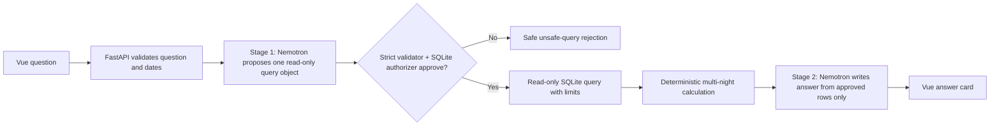

# Assignment 2 Part 2 — Chatbot Research and Early Design

**Status: research and early design completed October 11, 2026; backend
implementation and Vue interface completed October 12, 2026.** The two-stage
chatbot route and its keyboard-accessible Vue section now follow this design
with mocked backend-test coverage, a fixed JSON fixture, and a successful
production frontend build. On October 13, one user-authorized live request
completed with HTTP 200 through both Nemotron stages and rendered its grounded
answer in Vue. No package was installed, and no existing SQLite row, manually
edited nightly rate, or room count was changed. The implementation retains a
verified plain-text second-stage fallback for the free model's lack of enforced
JSON output.

The revised October 1 requirements available for this activity call for a
two-stage LLM workflow, strict read-only SQL handling, simulated multi-night
hotel answers, a fixed JSON sample, tests, a recorded demo, and an AI
disclosure. The exact rubric text is not stored in this repository, so the
decisions below should be checked against the instructor's current handout
before implementation.

## Design goal and boundaries

The chatbot will answer questions about the local, classroom hotel data. It is
not a booking agent and must not alter any data. In particular, it must preserve
the Assignment 1 `hotels`, `trips`, `users`, and `bookings` data as well as the
existing `saved_hotels` and `demo_hotel_nights` values.

For the first version, the SQL stage should be limited to these activity tables
and fields:

| Table | Allowed fields | Reason |
| --- | --- | --- |
| `saved_hotels` | `saved_hotel_id`, `provider_place_id`, `hotel_name`, `address`, `latitude`, `longitude`, `searched_zip_code` | Identifies the saved local hotel and its stored location. |
| `demo_hotel_nights` | `saved_hotel_id`, `stay_date`, `nightly_rate_cents`, `rooms_available` | Supplies the explicitly simulated classroom nightly price and availability. |

The chatbot must not query `users` or `bookings`, expose internal provider
identifiers to the user, call Geoapify, or make an availability/booking claim
beyond the stored simulated data. If a future rubric explicitly needs the
Assignment 1 search tables, that expansion requires a separate reviewed
allowlist.

## Provider research: OpenRouter and an NVIDIA Nemotron free option

### Proposed choice

Subject to instructor approval, use OpenRouter from FastAPI with a **specific
NVIDIA Nemotron model whose current OpenRouter model identifier ends in
`:free`**. Verify and pin the identifier during implementation rather than
putting a date-sensitive identifier in this design document. At the time of
research, OpenRouter's free-model collection listed NVIDIA Nemotron 3 Ultra,
Nemotron 3.5 Lightning, and Nemotron 3 Super as free options.

| Official source | Useful feature | Limitation and resulting decision |
| --- | --- | --- |
| [OpenRouter free-model collection](https://openrouter.ai/collections/free-models/) | Shows current free models, including NVIDIA Nemotron options, zero prompt/completion pricing, and the `openrouter/free` router. | The collection and rankings are dynamic. Do not promise a particular free model will remain available or use the generic free router when the assignment calls for a Nemotron option. Check availability at setup time. |
| [OpenRouter Models API](https://openrouter.ai/docs/api/api-reference/models/list-all-models-and-their-properties) | Lists model IDs, pricing, supported parameters, context information, and endpoint metadata. | The response requires an API key and can change. A startup/configuration check should select an approved NVIDIA `:free` ID from the catalog and fail clearly when none is available. |
| [OpenRouter quickstart](https://openrouter.ai/docs/cookbook/get-started/quickstart) | Demonstrates a server environment variable named `OPENROUTER_API_KEY` and changing models with the model string. | Its example is a Node SDK; this application is FastAPI/Python. Treat it as API/key-handling guidance, not a reason to install an SDK now. Use an approved Python HTTP client only when implementation begins. |
| [Nemotron 3 Ultra (free) model page](https://openrouter.ai/nvidia/nemotron-3-ultra-550b-a55b:free) | Confirms the configured NVIDIA model ID and its text chat capability. | The free endpoint does not support `response_format`, so strict JSON cannot be provider-enforced. Prompt for the JSON envelope, then accept only a bounded plain-text fallback whose facts are checked against local deterministic results. |

### Provider security and resilience decisions

- Store `OPENROUTER_API_KEY` only in the backend environment file. Never put it
  in Vue source, a browser request, an API response, a screenshot, test fixture,
  or Git.
- Send the provider request from FastAPI only. The browser receives a small,
  safe local result shape, not an upstream error body or model output metadata.
- Use an exact, configured model ID for reproducible tests and demonstrations.
  Do not use `openrouter/free`, because it chooses a free model for each request
  and does not guarantee the desired NVIDIA Nemotron model.
- Treat absent configuration, provider `401`/`403`, rate limits, timeouts, and
  network failures as distinct, beginner-readable UI states. Provider HTTP 5xx
  and malformed provider payloads are also distinct from network failures. Do
  not substitute a made-up answer and do not retry indefinitely.
- Free capacity, availability, rate limits, privacy terms, and provider routing
  are external and may change. The recorded demo should state the model ID and
  date used, while the fixed JSON test fixture remains deterministic offline.

## Safe LLM-generated SQL research and design

An LLM is untrusted text generation, not a database authorization layer. The
chatbot must reject unsafe SQL before it reaches SQLite and must use a
connection that cannot write even if validation fails.

| Official source | Useful feature | Limitation and resulting decision |
| --- | --- | --- |
| [SQLite URI filenames](https://www.sqlite.org/uri.html) | `mode=ro` opens a database read-only; Python's [`sqlite3` URI example](https://docs.python.org/3/library/sqlite3.html#how-to-work-with-sqlite-uris) shows `uri=True`. | Read-only opening is necessary but not the only control. Use it for a separate chatbot connection, not the application's regular read/write connection. |
| [SQLite `PRAGMA query_only`](https://www.sqlite.org/pragma.html#pragma_query_only) | Rejects `CREATE`, `DELETE`, `DROP`, `INSERT`, and `UPDATE` when enabled. | SQLite documents that it is not truly read-only: checkpoint and commit remain possible. Enable it only as a second guard, not as the sole control. |
| [SQLite authorizer callback](https://www.sqlite.org/c3ref/set_authorizer.html) | SQLite invokes an authorizer while compiling SQL and can deny the entire statement; the documentation explicitly identifies it as useful for SQL from an untrusted source. | An authorizer is connection-specific and must be configured every time a chatbot read connection is opened. Deny write, schema, attach/detach, transaction, pragma, and unapproved table/column actions. |
| [Python `sqlite3.Connection.set_authorizer`](https://docs.python.org/3/library/sqlite3.html#sqlite3.Connection.set_authorizer) and [progress handler](https://docs.python.org/3/library/sqlite3.html#sqlite3.Connection.set_progress_handler) | Python exposes the SQLite authorizer constants and can interrupt a costly query through a progress handler. | The implementation still needs an application-level statement/column allowlist, a small row limit, a query budget, and safe error mapping. |

### Required defense in depth

1. **Do not execute a natural-language request.** Stage 1 may return exactly
   one candidate query object with a `sql` string and a small, documented set of
   bound values. It may not request a tool, code execution, multiple statements,
   or a database filename.
2. **Validate the generated text before preparation.** Require a single
   `SELECT` statement or a `WITH … SELECT` statement. Reject blank SQL,
   semicolons, comments, multiple statements, write/schema/transaction/pragma
   keywords, unknown tables/columns, and any query without a bounded `LIMIT`.
   Token/regex screening alone is not sufficient; a parser/AST-aware allowlist
   should be chosen during implementation.
3. **Bind values separately.** Dates, ZIP codes, names, and numeric thresholds
   must be validated in Python and supplied as bound parameters—not interpolated
   into model-created SQL.
4. **Use a dedicated read-only connection.** Open a URI with `mode=ro` and
   `uri=True`, enable `PRAGMA query_only=ON`, and install a SQLite authorizer
   that permits only reads from the two allowlisted tables/columns. Deny
   `ATTACH`, `DETACH`, DDL, DML, `PRAGMA`, and transaction actions.
5. **Bound work and results.** Add an enforced small `LIMIT` (for example 25),
   a SQLite progress-handler budget, request timeouts, and an output-size limit.
   Return a clear rejection, not a raw SQL/database error, when a generated
   query is unsafe or too costly.
6. **Log safely.** Store only request IDs, outcome categories, and reviewed
   diagnostics. Do not log API keys, provider authorization headers, arbitrary
   prompts containing personal data, or raw rejected SQL by default.

The validator must be tested with normal hotel questions and hostile examples
such as `DROP TABLE saved_hotels`, multiple statements, `ATTACH`, `PRAGMA`, and
attempts to read `users` or `bookings`.

## Proposed two-stage workflow

### Stage 1: constrained query proposal

The server prompt should include only the current, hand-written schema contract,
the allowed fields, date rules, and a strict JSON response contract. It should
ask for a query capable of retrieving facts—not prose. FastAPI validates the
object and SQL; model compliance is never assumed.

### Deterministic calculation between stages

FastAPI, not the model, calculates cost and availability from approved rows.
For a proposed hotel/date range:

- Require ISO dates and `check_in < check_out`.
- Treat check-in as inclusive and check-out as exclusive, so October 10 to
  October 12 is two stored nights: October 10 and October 11.
- Require one stored `demo_hotel_nights` row for every requested night.
- Sum integer `nightly_rate_cents` values for the total; format currency only
  after calculation.
- Report the minimum `rooms_available` across the requested nights as the
  simulated availability. A missing night or a non-positive minimum means the
  hotel is not a complete matching stay; never invent a default price or room
  count.

This is a proposed convention for the early design. It must be adjusted if the
revised assignment handout defines dates differently.

### Stage 2: grounded response

Stage 2 receives the user's question plus the approved rows and deterministic
summary only. It cannot call the database or external tools. Its prompt must
say to identify simulated classroom data, use only supplied facts, say when no
complete match exists, avoid unsupported booking claims, and return a small
JSON answer contract that FastAPI validates before Vue renders it.

## Beginner-facing Vue interface states

The early mockup at
[`docs/assignment2-chatbot-early-mockup.svg`](assignment2-chatbot-early-mockup.svg)
shows the intended plain-language states:

| State | What the user sees | Proposed action |
| --- | --- | --- |
| Ready | Question input, helpful example, and **Send** button. | Ask about a saved local hotel and dates. |
| Loading | “Checking saved classroom hotel data…” and a disabled **Send** button. | Wait; the previous answer remains visible. |
| Successful recommendation | Hotel name, requested dates/nights, total simulated cost, and minimum available rooms, all labeled as simulated classroom data. | Ask another question or refine dates. |
| No matching hotels | Clear statement that no saved hotel has a complete matching stay. | Try other dates or save a hotel through the existing ZIP flow. |
| Invalid dates | Explanation that dates must use `YYYY-MM-DD` and checkout must follow check-in. | Correct the dates before a provider request. |
| Unsafe SQL rejection | “For safety, that request could not be used to query the database.” No raw SQL is revealed. | Rephrase as a hotel/date question. |
| Provider error | A configuration/authentication/rate-limit-safe message. | Try later or ask the instructor to check server setup. |
| Network error | “The local chatbot service could not be reached.” | Check the backend and retry. |

## Implementation status and remaining deliverables

Implemented on the backend:

1. `POST /api/chatbot` accepts a natural-language question, requires exactly
   two valid ISO dates, and returns a structured success/error body.
2. Stage 1 receives the fixed schema and exact SQL contract. Its proposed JSON
   is accepted only when it exactly matches the bounded approved query and uses
   the server-validated date parameters.
3. The query runs through a separate SQLite `mode=ro` connection with
   `query_only`, an authorizer, and a progress-handler budget. Only the two
   allowlisted saved-hotel tables can be read.
4. FastAPI calculates complete-stay totals in integer cents and minimum positive
   rooms before Stage 2 receives the retrieved local records and calculations.
5. `backend/test_chatbot.py` uses mocked provider replies, the tracked
   `backend/fixtures/chatbot-availability-fixture.json`, and temporary SQLite
   databases to cover successful grounding, checkout exclusion, missing nights,
   zero rooms, out-of-range demo dates, invalid dates,
   write/multiple-statement/unauthorized/unbounded SQL rejection,
   direct read-only enforcement, a model-unavailable error, strict first-stage
   JSON/fenced-JSON/prose-wrapped JSON extraction, malformed responses, JSON and
   plain-text answer parsing, ungrounded factual claims, and the endpoint response
   shape.

Completed technical evidence:

1. The fixed tracked JSON sample is
   `backend/fixtures/chatbot-availability-fixture.json`.
2. `docs/chatbot-verification.md` records the expected-versus-observed fixture
   results and the October 13 successful live workflow.
3. `report.md` identifies the provider/model limitation, test evidence, and
   AI-assisted implementation accurately.

Remaining submission artifact:

1. Record or attach any instructor-required screen-recorded chatbot demo. This
   is not fabricated by the codebase and is separate from the verified live UI
   observation above.

## Limitations to disclose later

- A free provider model is an external service; availability and behavior can
  change, and it is not a source of truth for hotel facts.
- The demo-night price and room data are simulated classroom data, not live
  inventory or a booking offer.
- An LLM can produce incorrect or unsafe text. The service therefore uses it
  only within the two constrained stages, with deterministic validation and
  calculation between them.
- The design does not implement local-first lookup changes, hotel saving,
  removal, map selection, authentication, payments, or a booking workflow; the
  already implemented versions of those features remain unchanged.
