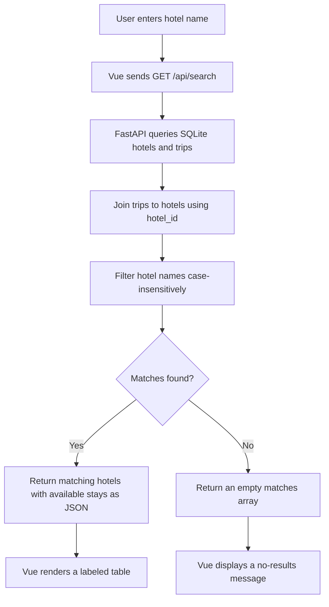

# Part 2 Foundation Design: Vue, FastAPI, and SQLite

## 1. Purpose and reference

This Part 1 application is a local hotel and available-stay search. [Expedia](https://www.expedia.com/) and the screenshots in `docs/reference-images/` are observable references for information hierarchy only. The project does not copy Expedia proprietary code, private data, or reproduce its interface exactly.

- [Expedia search reference](reference-images/expedia-search.png) informs the placement of search information and hotel results.
- [Expedia trips reference](reference-images/expedia-trips.png) informs the grouping of stored trip-style information and reservation details.

## 2. Current scope

The implemented scope is a hotel-name search. The user submits a name, sees matching hotels and their available stays in a plain table, or sees a clear no-results message.

Implemented in this milestone: SQLite schema creation, one-time instructor CSV seeding, SQLite-backed search, booking CRUD API routes, the Vue booking interface, an Assignment 2 Part 1 ZIP-code hotel map, and the Assignment 2 Part 2 in-class Add, Retain, Remove, and Local-first Lookup benchmarks. The map calls Geoapify only through FastAPI, verifies a five-digit U.S. ZIP result, and displays up to 20 nearby provider hotels within 5 km. The add action retains a selected live provider result and five simulated classroom nights; the remove action deletes only that saved result and its dependent nights; the local-first lookup returns matching saved results before Geoapify is contacted. Authentication and payments remain out of scope.

## 3. Architecture and responsibilities

| Layer | Implemented responsibility |
| --- | --- |
| Interface | Vue traveler selector, hotel-name search, ZIP input, nearby-hotel list, Leaflet map, Add to Local and saved-only Remove from Local actions, local/API result-source labels, stored simulated-night details, Book buttons for returned trips, status messages, and booking-history table with Cancel and Delete (test) actions. The ZIP list and markers share `selectedPlaceId`. |
| Logic | FastAPI initializes SQLite at startup, searches joined hotel/trip rows, looks up saved hotels first by ZIP, saves a selected live provider hotel only once with five simulated nights, removes a selected saved provider hotel through its foreign-key cascade, creates, reads, cancels, or deletes booking rows, and coordinates the server-side Geoapify geocoding/Places requests only after an empty local lookup. |
| Data | Instructor-supplied hotel, trip, user, and booking CSV files seed SQLite once. `saved_hotels` and `demo_hotel_nights` retain only activity-specific provider selections and simulated data. No hotel result data is stored in Vue source. |
| Communication | Browser `fetch()` calls FastAPI over local HTTP; FastAPI returns JSON. |

## 4. SQLite data model and seed source

`data/hotels.csv` has `hotel_id`, `hotel_name`, `city`, `state`, and `nightly_rate_usd`.

`data/trips.csv` has `trip_id`, `hotel_id`, `trip_name`, `check_in`, and `check_out`; `trips.hotel_id` references `hotels.hotel_id`.

`data/users.csv` has `user_id` and `display_name`. `data/bookings.csv` has `booking_id`, `user_id`, `trip_id`, `booked_on`, and `status`; bookings reference users and trips.

### Assignment 2 Part 2 in-class saved-hotel schema

`saved_hotels` is separate from the instructor-supplied `hotels` table. It stores a saved Geoapify place's unique `provider_place_id`, provider hotel name and address when available, latitude, longitude, and the five-digit ZIP code used for that search. This keeps external provider identity and location data out of the Assignment 1 hotel/trip model.

`demo_hotel_nights` stores simulated activity-only availability for a saved hotel. Its `saved_hotel_id` foreign key references `saved_hotels`, and the `(saved_hotel_id, stay_date)` constraint allows at most one record per hotel/night. The schema permits only October 10–14, 2026, and defaults each row to `nightly_rate_cents = 10000` and `rooms_available = 20`. The foreign key uses `ON DELETE CASCADE`, so deleting a saved hotel removes its related demo-night rows without affecting Assignment 1 records.

`GET /api/saved-hotels?zip_code=<ZIP>` reads only `saved_hotels` and their `demo_hotel_nights` rows for a validated five-digit ZIP. It returns the stored provider fields, `is_saved_locally`, and every stored simulated night without modifying them or contacting Geoapify. Vue calls this endpoint first; if it returns no matching saved hotels, Vue calls `GET /api/nearby-hotels` as the existing live fallback. `POST /api/saved-hotels` accepts only the selected live result's narrowed provider fields and searched ZIP. It inserts a new provider place once and creates its five night rows using the schema defaults. A repeat request for the same `provider_place_id` returns the existing saved row and does not update either the hotel or its nightly records. `DELETE /api/saved-hotels/{provider_place_id}` deletes only the matching saved row; SQLite's foreign key cascades deletion to its `demo_hotel_nights` rows.

FastAPI reads the CSV files with UTF-8 BOM handling only during the initial seed. A `seed_metadata` marker prevents reloads on later backend starts. `booking_id_state` keeps the highest issued booking number, so deleted test-booking IDs are not reused. Search requests use the persistent SQLite tables, and a matching response contains a hotel's fields plus an `available_stays` collection formed from joined trip rows.

## 5. Search flow

## 6. API contract

### `GET /api/search?hotel_name=<name>`

- **Input:** a non-empty `hotel_name` query parameter.
- **Output:** JSON with `search_term` and `matches`.
- **Each match:** hotel ID, name, city, state, nightly rate, and joined `available_stays` containing trip ID, name, check-in, and check-out.

### `GET /api/nearby-hotels?zip_code=<five-digit-zip>`

- **Input:** exactly five ASCII digits. Leading zeros are preserved.
- **Controller:** reads `GEOAPIFY_API_KEY` only from local backend configuration, geocodes with `countrycode:us` and `type=postcode`, and verifies the matching U.S. postcode before calling Places.
- **Provider search:** `accommodation.hotel` inside a fixed 5,000-metre circle centered on the verified geocode; request/display limit 20.
- **Output:** a safe outcome plus honest provider fields when available: provider place ID, hotel name, address/location, latitude, and longitude. It does not fabricate price, rating, availability, or booking information.
- **Saved-state flag:** each live result includes `is_saved_locally`, based solely on whether its provider place ID is already retained in `saved_hotels`.
- **Outcomes:** `success`, `invalid_zip`, `unresolved_zip`, `no_results`, `api_failure`, `authentication_failure`, `rate_limited`, and `configuration_error`.

### `POST /api/saved-hotels`

- **Input:** a live Geoapify result's provider place ID, optional provider name/address, validated coordinates, and the five-digit searched ZIP.
- **Effect:** creates one `saved_hotels` row and five `demo_hotel_nights` rows for October 10–14, 2026, using `$100.00` and 20 rooms as clearly labeled simulated classroom values.
- **Repeat behavior:** a duplicate provider place ID returns the existing row without overwriting saved hotel or night data.

### `GET /api/saved-hotels?zip_code=<five-digit-zip>`

- **Input:** exactly five digits; no provider request is made.
- **Output:** matching saved hotels labeled `is_saved_locally: true`, each with the stored October 10–14 simulated-night date, nightly rate in cents, and rooms available.
- **Empty result:** returns an empty hotel collection. Vue then calls the existing nearby-hotel endpoint and labels its response `API results`.
- **Errors:** a local database failure returns a safe error message; Vue displays it and does not fall back to Geoapify.
- **Map behavior:** local results fit the map to their stored marker coordinates. They do not draw the Geoapify 5 km circle because the local-first path deliberately does not resolve a live ZIP centroid.

### `DELETE /api/saved-hotels/{provider_place_id}`

- **Input:** the provider place ID of an already saved live result.
- **Effect:** deletes the matching `saved_hotels` row and lets SQLite cascade-delete only its five related `demo_hotel_nights` rows.
- **Errors:** a missing local save returns `404` with a clear message; database errors return a safe retry message.

### Booking API

- `GET /api/users` returns SQLite users for the traveler selector.
- `POST /api/bookings` accepts an existing `user_id` and `trip_id`, generates a unique `B`-prefixed ID, uses today's date, and defaults status to `confirmed`.
- `GET /api/bookings` returns history joined to user, trip, and hotel details.
- `PATCH /api/bookings/{booking_id}/cancel` changes only the status to `cancelled`.
- `DELETE /api/bookings/{booking_id}` removes an application-created test booking; instructor bookings `B001`–`B006` return `403` and have no Delete control in Vue.

Missing users, trips, or bookings return `404`; blank create identifiers return `422`.

## 7. User-visible states

| State | Expected interface behavior |
| --- | --- |
| Empty input | Prompt the user to enter a hotel name before searching. |
| Matching search | Show the number of matching hotels and a table containing hotel and available-stay details. |
| No results | Show `No hotels and available stays found for “<search term>”.` |
| Booking created | Show the generated booking ID and refresh booking history from FastAPI. |
| Booking cancelled | Keep the booking row and display `cancelled` after refreshing history. |
| Test booking deleted | Remove the row only after the API confirms deletion, then refresh history. |
| Backend unavailable | Show the API error message rather than presenting stale or invented results. |
| Invalid ZIP | Show a clear five-digit input message before calling the backend. |
| Unresolved ZIP | Show that Geoapify did not resolve the requested U.S. ZIP; do not call Places. |
| Nearby map result | Show the same provider hotels in a keyboard-operable list and Leaflet markers; selected list/marker state stays synchronized. |
| No nearby hotels | Show a provider empty-result message and keep it distinct from an API error. |
| Provider failure | Show a safe authentication, rate-limit, configuration, or generic request-failure message without exposing the key. |
| Add to Local | Save the selected live result once, show `Saved locally`, and disable the Add action. Clearly state that its five `$100.00`/20-room nights are simulated classroom data. |
| Remove from Local | Show the Remove from Local control only for a saved live result. On success, remove its saved label, restore its Add to Local action, and show a confirmation. On failure, retain the saved state and show the clear error. |
| Local-first ZIP search | For a valid ZIP, request local saves first. Matching saves show `Saved locally` plus their stored simulated nightly values and use the existing list/map selection. If local is empty, show `API results` from the existing Geoapify request; if local fails, show the error and make no fallback request. |

## 8. Verification plan

The student must manually inspect the changed files in VS Code and perform two browser searches after starting FastAPI and Vue:

| Test | Search term | Expected result | Observed result |
| --- | --- | --- | --- |
| Successful search | `Harbor Lantern Hotel` | `H001` appears with two stays: *Boston Harbor Weekend* and *Boston Autumn Weekend*. | Passed in browser: `T001` and `T009` displayed with Book buttons. |
| No-results search | `Moonlight Palace Hotel` | The clear no-results message appears and no results table is shown. | Passed in browser: the clear no-results message displayed. |

The same expected/observed record is maintained in `docs/evidence-log.md`.

## 9. Current state and next boundary

Implemented: Vue/Vite frontend source, FastAPI search and booking CRUD routes, a SQLite schema, one-time CSV seeding, SQLite `hotel_id` join logic, plain table rendering, traveler selection, booking history, cancellation, test deletion, the ZIP-code Geoapify hotel-map feature, and the in-class saved-hotel Add, Retain, Remove, and Local-first Lookup benchmarks. The saved-hotel actions create five explicitly simulated classroom nights, reflect persisted status on a later live ZIP search, remove only the selected local save with its dependent nights, and return stored local data before any Geoapify fallback. Browser tests passed for create, refresh persistence, cancellation, deletion, restart persistence, initial map rendering/attribution, invalid-ZIP feedback, local-first saved data, and empty-local API fallback. Focused backend tests simulate provider empty, failure, authentication, rate-limit, saved-hotel persistence, cascade removal, local-first saved retrieval, local errors, and unrelated-record preservation outcomes without spending provider quota.

Not yet implemented: authentication and payments. A non-empty local Geoapify key is required only for an empty-local live-provider fallback.

## 10. Assignment 2 Part 2 chatbot — implemented backend and Vue interface

The local hotel chatbot is implemented in FastAPI and Vue. The research and
early mockup are recorded separately in
[assignment2-chatbot-research.md](assignment2-chatbot-research.md) and
[assignment2-chatbot-early-mockup.svg](assignment2-chatbot-early-mockup.svg).
`POST /api/chatbot` uses the configured server-only OpenRouter NVIDIA Nemotron
model for two stages: it requests one constrained SQL-proposal JSON object,
then sends only approved local records and deterministic calculations to the
grounded-answer stage. The answer stage requests an exact JSON `answer` object;
because the selected free Nemotron endpoint does not enforce `response_format`,
FastAPI also accepts a bounded plain-text fallback only after verifying every
displayed date, currency amount, room count, and hotel-style name against the
deterministic local results. It returns structured `status`, question, stay metadata,
proposed SQL, retrieved records, final answer, and safe error information.
Provider failures are classified without retaining provider bodies: unavailable
HTTP 5xx responses, timeouts, rate limits, network failures, invalid provider
payloads, authentication failures, and unavailable models remain distinct.

The backend uses a dedicated `mode=ro` SQLite connection, `query_only`, a
connection authorizer, table/column allowlists, parameter binding, a fixed
25-row query limit, and a progress budget. It accepts exactly two ISO dates,
treats checkout as exclusive, sums integer cents, and requires every requested
night to have positive stored rooms before declaring a complete stay. It
intentionally does not alter the existing
Assignment 1 records, saved-hotel records, manually edited demo-night rates or
room counts, ZIP/map behavior, Add to Local behavior, or Remove from Local
behavior. Tests mock OpenRouter and run against temporary databases. The Vue
section is labeled **Hotel AI Assistant** and sends a keyboard-submittable local
`fetch()` request only to `POST /api/chatbot`; it never receives an API key or
calls OpenRouter directly. It disables duplicate sends, announces loading and
safe error states, and displays returned stay dates, totals, and availability
with explicit simulated-classroom-data labels. The fixed JSON evidence artifact,
expected-versus-observed verification log, final report, and local UI captures
are now available. The only remaining non-code evidence item is an
instructor-accessible screen recording, if required by the rubric.
