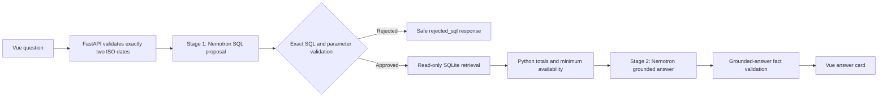

# Assignment 2 Part 2 — Grounded Local-Hotel Chatbot

## Submission information

- **Repository:** [travelbooking-app](https://github.com/clarissaalessi1-creator/travelbooking-app)
- **Branch:** [`assignment2_part2_chatbot`](https://github.com/clarissaalessi1-creator/travelbooking-app/tree/assignment2_part2_chatbot)
- **Implementation commit:** [`41247b3`](https://github.com/clarissaalessi1-creator/travelbooking-app/commit/41247b3)
  — `Complete Assignment 2 Part 2 chatbot`.
- **Report location:** `report.md` at the repository root.
- **Demonstration:** no recording link is invented. See the required recording
  checklist in [docs/evidence/demo-recording-checklist.md](docs/evidence/demo-recording-checklist.md).

## Project overview and objective

This project preserves the existing Assignment 1 hotel search and booking
features, Assignment 2 Part 1 ZIP/map feature, and the completed local hotel
storage activity. Assignment 2 Part 2 adds a **Hotel AI Assistant** that answers
natural-language questions about *saved local hotels only*. It is a classroom
demonstration of retrieval-augmented generation (RAG), not a booking or live
inventory system.

The assistant first asks an LLM to propose a constrained read-only SQL query.
FastAPI validates that proposal, retrieves the approved SQLite facts, calculates
multi-night totals deterministically, and asks the LLM a second time to write an
answer grounded only in those records. Every price and availability value shown
to the user is explicitly labeled simulated classroom data.

## Research and design basis

RAG combines a model with retrieved source material instead of relying only on
the model's learned knowledge. The original RAG paper describes generation that
is conditioned on retrieved evidence; this project uses the same practical idea
with a local SQLite retrieval step rather than an external vector database.
[Lewis et al., *Retrieval-Augmented Generation for Knowledge-Intensive NLP
Tasks*](https://arxiv.org/abs/2005.11401) informed that design.

The SQL proposal is treated as untrusted input. SQL injection prevention is not
delegated to a prompt: the proposal must pass a fixed allowlist, parameters are
bound separately, and SQLite itself has additional read-only guards. The
[OWASP SQL Injection Prevention Cheat Sheet](https://cheatsheetseries.owasp.org/cheatsheets/SQL_Injection_Prevention_Cheat_Sheet.html)
supports parameterized queries and allowlists as core defenses.

The configured provider is OpenRouter with
`nvidia/nemotron-3-ultra-550b-a55b:free`. Its official model page describes it
as a reasoning model and notes that the free endpoint does not support
`response_format`, so a prompt cannot force JSON at the provider level.
[OpenRouter Nemotron 3 Ultra (free)](https://openrouter.ai/nvidia/nemotron-3-ultra-550b-a55b:free)
and the [OpenRouter Chat Completions reference](https://openrouter.ai/docs/api/api-reference/chat/create-a-chat-completion)
guided the backend request shape and error handling. The backend therefore
requests a compact JSON envelope, safely extracts a single JSON object from
plain text or a code fence when present, and rejects malformed SQL proposals.
For the second stage only, it permits a plain-text answer after deterministic
fact validation because the model cannot enforce the JSON response format.

SQLite-specific defenses are based on the [SQLite URI filename documentation](https://www.sqlite.org/uri.html),
the [SQLite authorizer API](https://www.sqlite.org/c3ref/set_authorizer.html),
and Python's [sqlite3 documentation](https://docs.python.org/3/library/sqlite3.html).

## Early mockup and design decisions

The early beginner-facing mockup is included at
[docs/assignment2-chatbot-early-mockup.svg](docs/assignment2-chatbot-early-mockup.svg).
It planned a question field, Send button, loading state, a successful answer,
no-match, invalid-date, unsafe-SQL, provider-error, and network-error states
before implementation.

The final interface keeps those decisions: it is keyboard accessible, submits
with Enter, disables duplicate submissions while loading, uses live status text,
and shows the returned dates, per-night rates, total, and minimum room count.
It does not expose OpenRouter credentials or contact OpenRouter from Vue.

## Final architecture and two-stage workflow



1. Vue posts `{"question": "..."}` only to `POST /api/chatbot`.
2. FastAPI requires exactly two valid `YYYY-MM-DD` dates with check-in before
   checkout.
3. Stage 1 receives the question, the limited schema, validated dates, and a
   strict request for a SQL/parameters object.
4. The backend executes no model text unless it matches the one approved
   `SELECT ... JOIN ... WHERE ... LIMIT 25` template and the two validated date
   parameters exactly.
5. The separate read-only SQLite connection retrieves only `saved_hotels` and
   `demo_hotel_nights` records.
6. Python calculates a complete stay, total cents, and minimum rooms. Stage 2
   receives the original question plus only approved local records and those
   deterministic calculations.
7. The final answer is accepted only if its hotel name, dates, dollar values,
   night count, and room count can be verified against the local result.

## Database integration, dates, and calculations

The chatbot reads these two local tables only:

| Table | Relevant fields | Purpose |
| --- | --- | --- |
| `saved_hotels` | `saved_hotel_id`, `hotel_name`, `address`, `searched_zip_code` | Identifies a saved local hotel. |
| `demo_hotel_nights` | `saved_hotel_id`, `stay_date`, `nightly_rate_cents`, `rooms_available` | Stores simulated nightly pricing and availability. |

Check-in is inclusive and checkout is exclusive. For October 10 to October 12,
the billable nights are October 10 and October 11. Python sums integer cents
rather than floating-point prices. A hotel matches only when every required
night exists and every `rooms_available` value is positive; availability is the
minimum rooms value over the stay. Missing nights and zero rooms return a
no-match result rather than an invented price or availability claim.

## SQL safety protections

The application uses defense in depth:

- a fixed table and column allowlist;
- a strict single-query comparison against the approved SQL template;
- separate bound date parameters;
- rejection of comments, semicolons, writes, DDL, transactions, PRAGMA,
  unauthorized tables, and unbounded statements;
- a `mode=ro` SQLite URI connection and `PRAGMA query_only = ON`;
- a SQLite authorizer that permits only `SELECT`/approved reads;
- a progress-handler budget and a fixed 25-row result limit; and
- safe structured errors that do not return credentials, provider bodies, or
  raw rejected SQL to the browser.

The LLM still genuinely proposes the SQL object. The backend never substitutes
a hardcoded query when parsing fails; it returns `rejected_sql` instead.

## Frontend behavior

The Vue **Hotel AI Assistant** section has a labeled text input and Send button,
supports Enter submission, exposes loading through a disabled `Sending…` button,
and prevents duplicate requests. It renders a clear final answer, requested
stay, per-night rate/room records, total price, and minimum availability. It
labels all stored prices and room counts as simulated classroom data.

The browser-facing status mapping handles no matches, invalid dates, rejected
SQL, missing configuration, unavailable models, authentication failure, rate
limits, provider timeouts, provider/network/invalid-response errors, local
database errors, and local network errors. The existing hotel search, ZIP map,
local-first lookup, Add to Local, Remove from Local, and booking views remain
independent of the chatbot.

## Verified successful scenario

On October 13, 2026, one user-authorized live request used the configured free
Nemotron model with this question:

> Which saved hotel has rooms from 2026-10-10 to 2026-10-12?

The request returned HTTP 200 with `status: success`. Stage 1 produced a
parseable SQL proposal and the validated date parameters. The guarded query
retrieved two rows: October 10 at `$125.00` with 7 rooms and October 11 at
`$100.00` with 20 rooms. The deterministic total was `$225.00` for two nights
and the minimum availability was 7 rooms. Stage 2 returned an answer that passed
the grounding validation and was rendered by Vue.

The saved provider row has a null hotel name. The application correctly said
“saved local hotel” and displayed “Saved hotel name unavailable” instead of
inventing a hotel name. A live result table and expected-versus-observed record
are in [docs/chatbot-verification.md](docs/chatbot-verification.md).

## No-match, insufficient-data, unsafe-SQL, and provider scenarios

The isolated tests cover missing nights, zero rooms, and dates outside the
stored simulated period; each produces `no_matches` after only the mocked first
stage. Invalid or reversed dates are rejected before either provider call.

Unsafe mock proposals include a write statement, multiple statements, an
unauthorized `bookings` query, and an unbounded query. Every one is rejected
before SQLite execution, while the temporary test database remains unchanged.
Mocked tests also cover unavailable models, provider HTTP 5xx, timeout, network,
rate-limit, invalid-response, and reasoning-only responses. These are test
evidence, not claims that a particular live provider outage occurred.

## Fixed fixture and expected-versus-observed evidence

The tracked fixture
[backend/fixtures/chatbot-availability-fixture.json](backend/fixtures/chatbot-availability-fixture.json)
contains the exact approved SQL shape, date parameters, two nightly records,
and expected complete-stay values. The chatbot test suite loads it against a
temporary SQLite database. [docs/chatbot-verification.md](docs/chatbot-verification.md)
records the expected-versus-observed offline results and separately documents
the one live result.

The evidence index is [docs/evidence/README.md](docs/evidence/README.md). It
clearly labels genuine local UI captures versus mocked automated-test evidence.
No screenshot is presented as a live LLM success screenshot unless it was
captured during that live interaction.

## Automated verification

The final local verification ran:

```sh
PYTHONPYCACHEPREFIX=/private/tmp/travelbooking-pycache \
  backend/.venv/bin/python -m unittest discover -s backend -p 'test*.py' -v

cd frontend
npm run build

git diff --check
```

Result: **40 backend tests passed**, the Vue production build passed, and
`git diff --check` was clean. Tests use temporary databases for mutations. A
read-only check afterward confirmed 8 hotels, 12 trips, 6 users, 6 bookings,
1 saved hotel, and 5 demo-night rows. The manually edited October 10/11 values
remain 12,500 cents/7 rooms and 10,000 cents/20 rooms.

## Local startup instructions

From the repository root:

```sh
python3 -m venv backend/.venv
source backend/.venv/bin/activate
pip install -r backend/requirements.txt
uvicorn main:app --app-dir backend --host 127.0.0.1 --port 8000 --reload
```

In a second terminal:

```sh
cd frontend
npm install
npm run dev -- --host 127.0.0.1 --port 5173
```

Open `http://127.0.0.1:5173/` and verify the backend at
`http://127.0.0.1:8000/api/health`. Add local secrets only to ignored
`backend/.env` using the placeholders in `backend/.env.example`:

```dotenv
GEOAPIFY_API_KEY=your_key_here
OPENROUTER_API_KEY=your_key_here
OPENROUTER_MODEL=nvidia/nemotron-3-ultra-550b-a55b:free
```

## Known limitations

- The free model is an external service. Its availability, rate limits, and
  output formatting can change.
- The selected free Nemotron model does not enforce `response_format`; malformed
  SQL proposals remain safely rejected, and only grounded plain-text final
  answers are accepted as a fallback.
- Rates and rooms are simulated classroom data, not a booking offer or live
  inventory.
- The current saved provider record lacks a hotel name. The UI preserves that
  fact instead of fabricating one.
- No screen recording has been created or linked in this repository. The
  checklist identifies the exact genuine sequence to record.

## AI-use disclosure

OpenAI Codex assisted with repository inspection, design research, code and
test drafting, documentation, local browser verification, and command
execution under student direction. The student remains responsible for reviewing
the code, testing, recording the demonstration, and submitting the work.

Codex helped formulate the two-stage prompts: (1) “Return only a JSON object
with `sql` and `parameters` for the supplied limited schema and validated
dates,” and (2) “Answer only from the supplied retrieved records and
deterministic complete-stay values, labeling them simulated classroom data.”
OpenRouter's Nemotron model generated the actual SQL proposal and grounded
answer only during the one authorized live check described above.

Unsuccessful approaches were documented rather than hidden: an earlier
second-stage response did not match the requested JSON envelope, so the backend
was revised to accept only a fact-checked plain-text fallback; some first-stage
responses were not parseable SQL objects and remained safely rejected. These
revisions did not loosen the exact SQL allowlist or SQLite read-only controls.
Results were verified with mocked provider responses, temporary SQLite
databases, a fixed JSON fixture, a production Vue build, `git diff --check`,
read-only database inspection, and one user-authorized end-to-end live request.
